<h1 align="center">Image Prompt Reconstruction</h1>

<p align="center">
  <strong>把参考图写成可复用的生图提示词</strong><br>
  先描述构图与比例，再补光线、颜色和细节。
</p>

<p align="center">
  <a href="#快速开始">快速开始</a> ·
  <a href="#更多案例">案例对比</a> ·
  <a href="#模型与评测">模型与评测</a> ·
  <a href="SKILL.md">通用指令</a>
</p>

<p align="center"><sub>Agent Skill · v5 · 12 张参考图 · 6 类场景 · 6 组生成对比</sub></p>

| 原图 | 反推提示词 → GPT Image 2 |
|:---:|:---:|
| 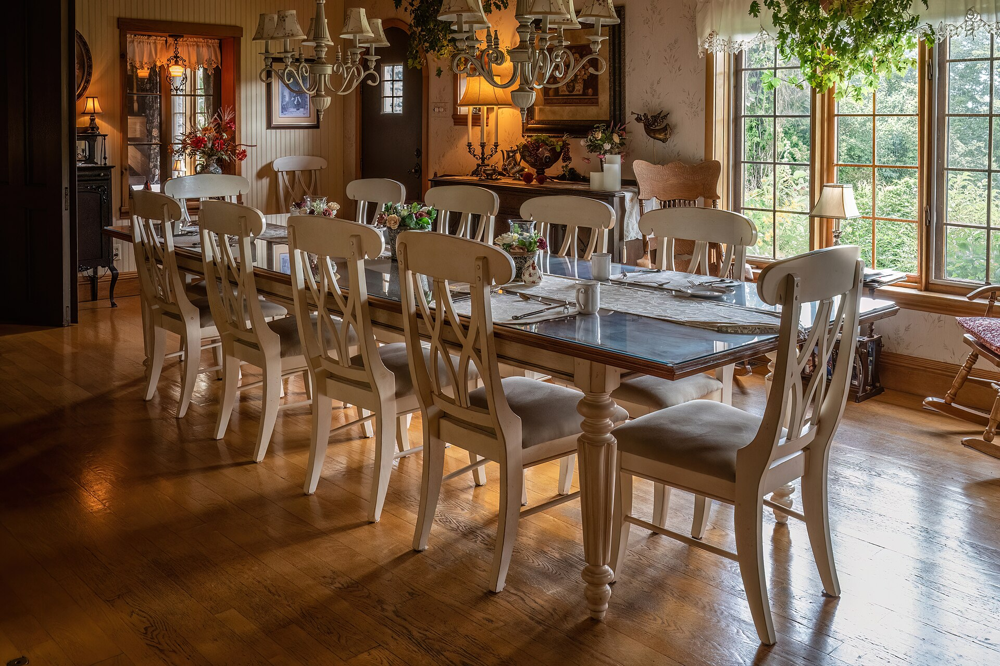 | 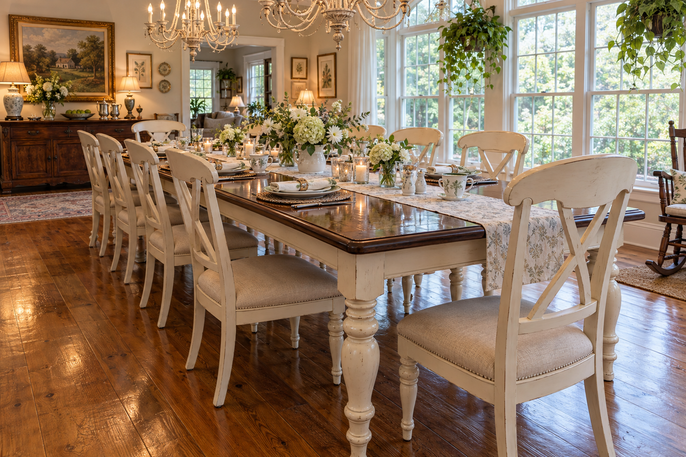 |

餐厅示例：桌椅关系保留，花团、灯具和桌腿细节仍有变化。右图只接收反推英文，没有输入原图。

[英文原文](examples/s21/prompt.txt) · [检查记录](examples/s21/case.json) · 原图：Wilfredor，CC0 1.0，[来源与完整署名](ATTRIBUTION.md#sources)。

> 本页案例统一用 `openai-codex/gpt-6-astra` 反推、GPT Image 2 生图。展示真实差异，不代表精确复刻或找回原作者提示词。

## 快速开始

在项目目录运行，需要 Node.js 与 npm：

```bash
npx skills add 0xsline/image-prompt-reconstruction \
  --skill image-prompt-reconstruction
```

选择客户端安装，新开会话，附上图片后说：

```text
用 image-prompt-reconstruction 反推这张图。
保存首次英文提示词和运行记录，暂时不要生图。
```

助手会实际查看图片，按同一条指令描述位置、比例、遮挡与外观，保存 `prompt_en.txt` 和 `record.json`。需要验证时，再要求它用完整英文生成图片。首次英文不被后续修订覆盖。

需要支持看图和文件操作的助手；生图还需要宿主提供相应工具。仓库不含模型，处理方式和费用取决于客户端，**本地 skill 不等于离线推理**。

<details>
<summary>手动安装、直接使用指令与批量处理</summary>

**手动安装**，适用于支持项目级 `.agents/skills/` 的客户端：

```bash
mkdir -p .agents/skills
git clone https://github.com/0xsline/image-prompt-reconstruction.git \
  .agents/skills/image-prompt-reconstruction
```

其它客户端请换成其技能目录，保留 `SKILL.md` 与 `references/`。不要覆盖已有修改。如果没有自动发现，可明确要求助手读取安装目录的 `SKILL.md` 后执行；未验证所有客户端的自动触发。

**不安装**，复制 [通用英文指令](SKILL.md#通用指令-v5)，连同图片交给视觉模型。这种方式只返回文字，不会自动保存记录。

**批量处理**，可以这样请求：

```text
用同一条通用指令逐张反推这些图片，每张单独保存。
对选定的图片，用完整英文各生成一次，不向生成模型传原图。
保留失败结果，不按结果逐图改词。模型不可用时直接说明。
```

每图使用独立目录。`record.json` 记录源图和提示词的 SHA-256、指令版本、实际模型与执行方式，未知字段写 `unknown`。译文、修订稿和参考图生成结果另存，不混入首次纯文结果。

</details>

## 更多案例

以下五组与页首餐厅示例使用相同指令和模型。点击类别展开，左侧是原图，右侧是反推后生成的图。

<details>
<summary><strong>食物 · 松饼的占比变化</strong></summary>

| 原图 | 反推提示词 → GPT Image 2 |
|:---:|:---:|
| 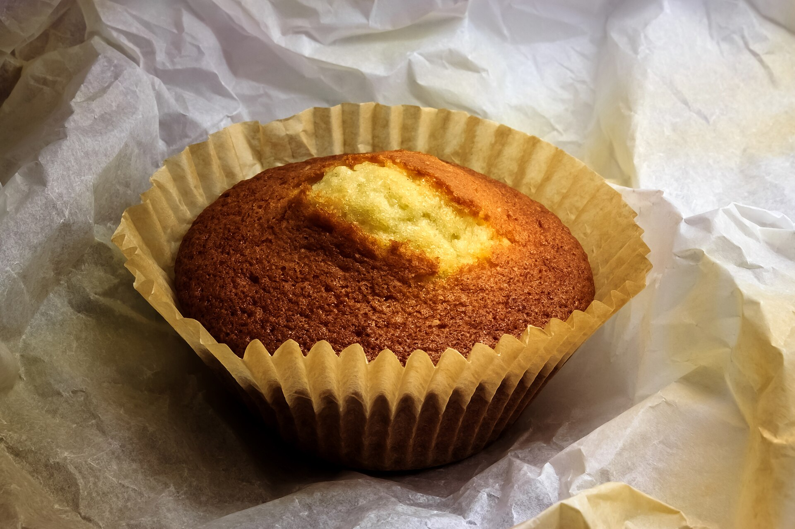 | 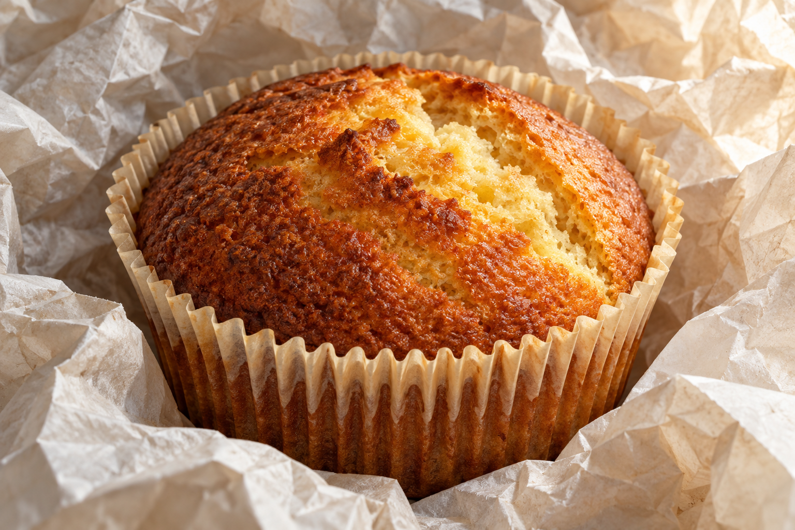 |

颜色、纸杯和顶部裂口保留，但松饼与纸杯的外接框面积约占画面的 62%，原图约 48.3%，超过预设容差。

[英文原文](examples/s17/prompt.txt) · [检查记录](examples/s17/case.json) · 原图：W.carter，CC BY-SA 4.0，[来源与完整署名](ATTRIBUTION.md#sources)。

</details>

<details>
<summary><strong>动物 · 斑点保留，姿态改变</strong></summary>

| 原图 | 反推提示词 → GPT Image 2 |
|:---:|:---:|
| 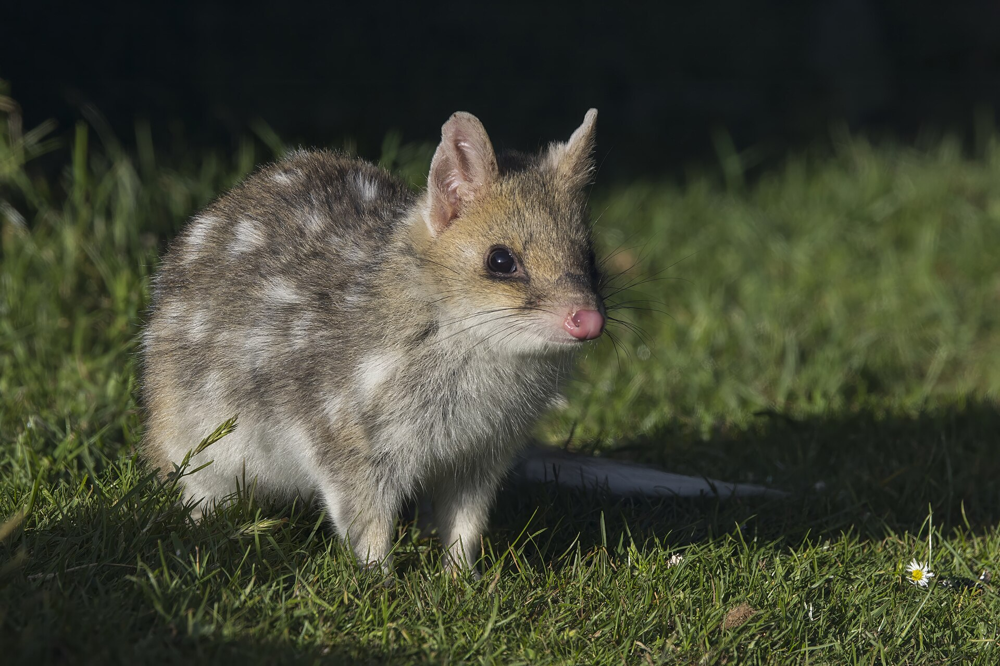 | 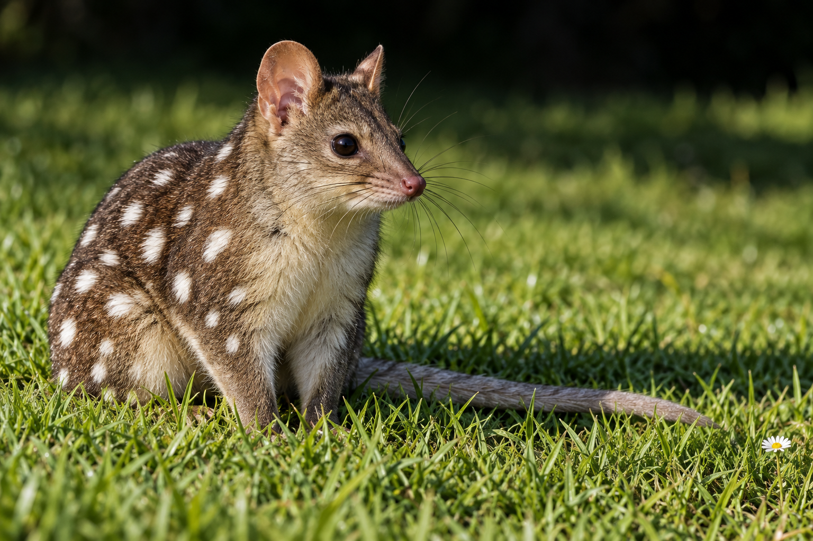 |

生成图保留了斑点、草地和大致朝向，但动物的姿态、位置和轮廓范围不同。识别出动物类别不等于复现它在画面中的状态。

[英文原文](examples/s19/prompt.txt) · [检查记录](examples/s19/case.json) · 原图：Charles J. Sharp，CC BY-SA 4.0，[来源与完整署名](ATTRIBUTION.md#sources)。

</details>

<details>
<summary><strong>建筑 · 整体轮廓与局部细节</strong></summary>

| 原图 | 反推提示词 → GPT Image 2 |
|:---:|:---:|
| 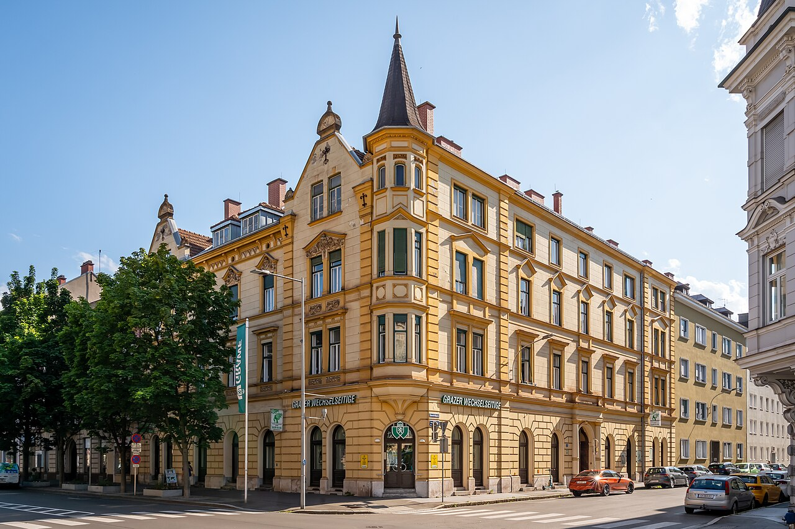 | 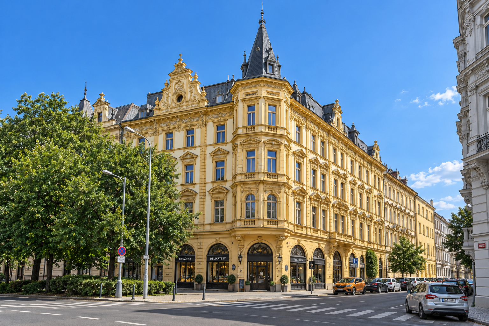 |

大轮廓和位置符合 4 条预设条件，窗户、装饰和其它建筑细部仍被重新组合。这里检查的是有限的可见关系，不是建筑测绘精度。

[英文原文](examples/s23/prompt.txt) · [检查记录](examples/s23/case.json) · 原图：Aciarium，CC BY 4.0，[来源与完整署名](ATTRIBUTION.md#sources)。

</details>

<details>
<summary><strong>汽车 · 配色与款式的区别</strong></summary>

| 原图 | 反推提示词 → GPT Image 2 |
|:---:|:---:|
| 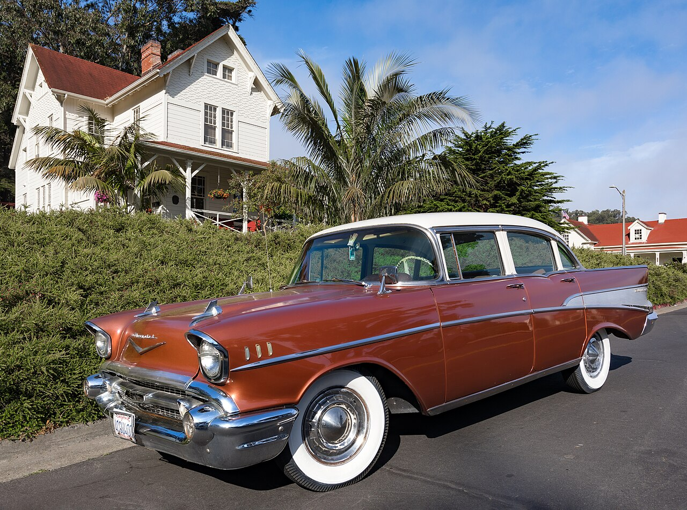 | 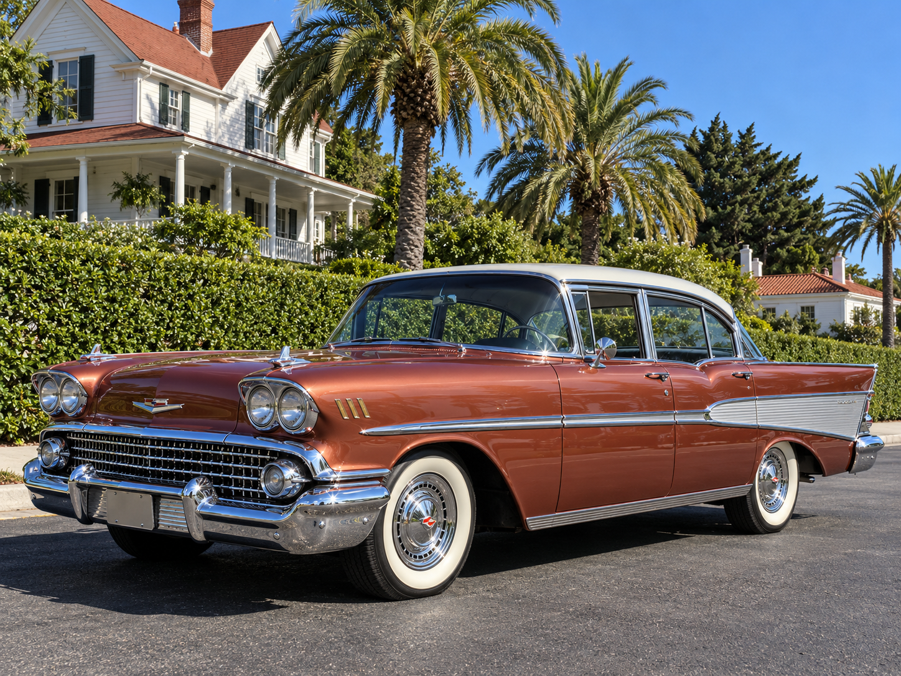 |

红白配色和街景关系保留，车身边界超出预设容差，车头结构与具体款式也不同。这类结果不能作为商品同款展示图。

[英文原文](examples/s25/prompt.txt) · [检查记录](examples/s25/case.json) · 原图：© Frank Schulenburg / CC BY-SA 4.0，[来源与完整署名](ATTRIBUTION.md#sources)。

</details>

<details>
<summary><strong>绘画 · 人物尺度与笔触漂移</strong></summary>

| 原图 | 反推提示词 → GPT Image 2 |
|:---:|:---:|
| 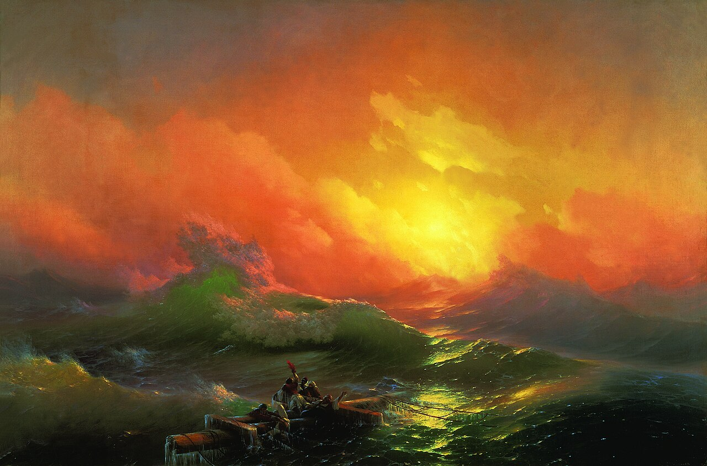 |  |

前后层次保留，但人物与木质残骸变大，画面占比和绘画质感不符。生成图更细致，不代表更接近原画。

[英文原文](examples/s27/prompt.txt) · [检查记录](examples/s27/case.json) · 原作：Ivan Aivazovsky，来源标记 PD-Art，[地域条件与来源](ATTRIBUTION.md#sources)。

</details>

[查看全部 12 个案例文件](examples/) · [原图署名与许可](ATTRIBUTION.md)

另有 6 张仅完成文字反推，未生成图片。下载完整仓库后，双击 `examples/index.html` 可离线切换、放大和复制提示词。[GitHub 上的 HTML 文件](examples/index.html) 显示源码，不是在线画廊。

## 模型与评测

| 阶段 | 模型 | 本次条件 |
|---|---|---|
| 图片反推 | `openai-codex/gpt-6-astra` | 原图 + 固定 v5 指令，工具辅助视觉代理 |
| 图片生成 | GPT Image 2 | 完整英文，`medium`，每张一次，无参考图，不控制种子 |

生图请求标识为 `openai-codex/gpt-image-2`，返回标识为 `gpt-image-2-codex`。五张输出为 1536 × 1024，汽车为 1448 × 1086。每例的原始英文、尺寸、哈希和逐项判断保存在对应的 `case.json` 与 `prompt.txt` 中。

<details>
<summary>查看评测结果与方法</summary>

每张图在反推前固定 4 条可见条件，反推执行器不读取这些答案或来源标题。生图样本预先选定，只生成一次，没有重跑挑选。

| 检查对象 | 数量 | 结果 |
|---|---:|---|
| 首次英文 | 48 条 | 完整支持 29 条，部分覆盖 19 条 |
| 实际生成图 | 24 条 | 通过 17 条，不通过 7 条 |
| 未生图样本 | 24 条 | `not_generated`，不计通过或零分 |

评审由 AI 视觉代理完成，边界为视觉估计，不是人工专家共识或像素分割。每类只有一张实际生图，公开样图也可能已在训练数据中，结果不是总体准确率。室内和建筑各通过 4 条限定检查，仍不等于整图复刻；没有旧版本对照，不能据此声称 v5 全面更好。

完整方法见 [references/evaluation.md](references/evaluation.md)。

</details>

文字中的百分比不是几何控制。商品款式、精确数量、复杂文字、遮挡与笔触仍可能变化；严格复刻需要另行验证参考图或布局控制，不能与纯文结果混算。其它模型的效果也需要单独测试。

## 文档与贡献

- [SKILL.md](SKILL.md)：适用场景、执行规则和完整 v5 指令
- [评测方法](references/evaluation.md)：冻结样本、记录首次输出、分开判断文字与图片
- [案例目录](examples/)：原图、提示词、实际生成图和检查记录

欢迎提交失败案例。请附可再分发的来源许可、首次英文、实际模型、生成条件和可见差异。改通用指令时，另留未参与调试的图片验证，不只上传最好的一次结果。

<details>
<summary>项目结构与参考</summary>

```text
SKILL.md                  核心指令
references/evaluation.md  评测方法
examples/index.html       离线画廊
examples/data.js          画廊数据
examples/s17/             单个案例，其它编号同理
  source.jpg              原图
  prompt.txt              首次英文
  generated.webp          生图，仅六个案例有此文件
  case.json               来源、模型和评审记录
ATTRIBUTION.md            素材署名与许可
LICENSE                   代码与文档许可
```

技能结构参考 [Anthropic Skills](https://github.com/anthropics/skills)、[Vercel Agent Skills](https://github.com/vercel-labs/agent-skills) 和 [OpenAI Creative Production](https://github.com/openai/plugins/tree/main/plugins/creative-production/skills/produce)。README 的图片展示与信息分层参考 [baoyu-design](https://github.com/JimLiu/baoyu-design) 和 [baoyu-skills](https://github.com/JimLiu/baoyu-skills)，未复制它们的任务指令。

</details>

## 许可

指令、项目说明和画廊代码采用 [MIT](LICENSE)，**不覆盖案例资产**。原图保留各自的 CC 许可或有地域条件的公有领域状态，详见 [ATTRIBUTION.md](ATTRIBUTION.md)。

项目可许可的案例提示词、评审数据和生成图采用 CC BY-SA 4.0，不保证 AI 产物在各司法辖区都具有版权。再分发时保留对应原图的署名与许可，不暗示原作者认可生成结果。
